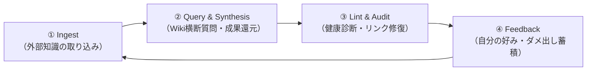

# LLM Wiki 運用ガイド（自然言語 ＆ コマンドリファレンス）

本ドキュメントは、Andrej Karpathy提唱の「LLM Wiki」を日常的に操作・運用するためのリファレンスです。  
AIエージェントに対する**自然言語（プロンプト）での頼み方**と、ターミナルやCLIを使った**コード・コマンドでの頼み方**をシーン別に対比してまとめています。

---

## 🧭 基本運用の4大サイクル



---

## 1. 外部知識の取り込み (Ingest)

Web記事、論文、議事録、メモなどの生データをWikiへコンパイル（要約・エンティティ抽出・概念整理・リンク付け）させる操作です。

### 💬 自然言語での頼み方
| やりたいこと | プロンプト例 |
| :--- | :--- |
| **URLから直接取り込む** | 「このWeb記事をWikiに取り込んで：`https://example.com/article`」 |
| **テキストを直接渡す** | 「以下の文章を生ソースとして保存して、要約と概念ページをWikiに反映して：\n\n（本文を貼り付け）」 |
| **置いたファイルを処理させる** | 「`raw/pending/` に置いた `article.md` をWikiに取り込んで、完了したら `raw/ingested/` に移して」 |
| **特定トピックを重点抽出** | 「この記事を取り込んでほしい。特に『セキュリティ設計』と『コスト比較』の観点を重点的に概念ページへまとめて」 |
| **画像の解説も含めて取り込む** | 「`raw/assets/architecture.png` の図を見ながら、記事内容と図の構造をWikiに反映して」 |

### 💻 コード・コマンドでの頼み方
```powershell
# 1. 蒸留待ちフォルダに生ファイルを配置して取り込みを指示
# （ファイルを pending に保存）
Set-Content -Path "C:\Users\kuseg\lab\16_cxt_db\raw\pending\new-source.md" -Value "記事本文..." -Encoding UTF8

# 2. 取り込み後のWiki統計を確認
python C:\Users\kuseg\lab\16_cxt_db\scripts\wiki_cli.py stats

# 3. 直近のログを確認（Ingestが成功したか検証）
Get-Content -Path "C:\Users\kuseg\lab\16_cxt_db\log.md" -Tail 10
```

---

## 2. 蓄積知識の検索・質問 (Query & Synthesis)

Wiki内に事前コンパイルされた知識をもとに回答を作成させ、価値ある成果をWikiに還元する操作です。

### 💬 自然言語での頼み方
| やりたいこと | プロンプト例 |
| :--- | :--- |
| **Wiki横断の質問** | 「Wiki内の知識をもとに、RAGとLLM Wikiの最大の違いを初心者向けに説明して」 |
| **複数概念の比較分析** | 「`concepts/` にある技術Aと技術Bのメリット・デメリットを比較表にして」 |
| **成果のWiki還元（重要）** | 「この比較分析の内容を、後から再利用できるように `synthesis/` フォルダに新しいページとして保存し、`index.md` にも追加して」 |
| **特定人物・ツールの情報取得** | 「Wiki内で `Andrej Karpathy` が言及されているページを全部洗い出して、彼の主張の変遷をまとめて」 |
| **プレゼン・スライド生成** | 「Wikiの『3層アーキテクチャ』の解説をもとに、Marp形式のスライド（5枚）を作って」 |

### 💻 コード・コマンドでの頼み方
```powershell
# 1. CLIによるキーワード全文検索（該当ファイルと行番号を即時表示）
python C:\Users\kuseg\lab\16_cxt_db\scripts\wiki_cli.py search "Karpathy"
python C:\Users\kuseg\lab\16_cxt_db\scripts\wiki_cli.py search "RAG"

# 2. index.md（全体カタログ）を直接確認
Get-Content -Path "C:\Users\kuseg\lab\16_cxt_db\index.md"

# 3. 作成された合成レポート（synthesis）を一覧表示
Get-ChildItem -Path "C:\Users\kuseg\lab\16_cxt_db\synthesis" -Filter *.md
```

---

## 3. Wikiの整合性チェック・健康診断 (Lint)

Wikiが成長するにつれて発生するリンク切れ、孤立ページ、知識の矛盾、情報の陳腐化を解消する操作です。

### 💬 自然言語での頼み方
| やりたいこと | プロンプト例 |
| :--- | :--- |
| **定期健康診断** | 「Wiki全体のLint（整合性チェック）を実行して、リンク切れや孤立ページがあれば直して」 |
| **未作成ページの洗い出し** | 「多くのページで言及されているのに、まだ単独ページ（`concepts/` や `entities/`）がない重要キーワードはある？あれば作成して」 |
| **知識の矛盾・古い情報の更新** | 「最新のソースと昔のページで主張が食い違っている箇所がないか精査して。見つかったら新旧の比較を併記して」 |
| **目次（index.md）の同期** | 「新しく増えたファイルが `index.md` に漏れなく入っているか確認して更新して」 |

### 💻 コード・コマンドでの頼み方
```powershell
# 1. CLIツールによる整合性・リンク切れ・孤立ページの自動診断
python C:\Users\kuseg\lab\16_cxt_db\scripts\wiki_cli.py lint

# 2. 統計情報の表示（ページ数、リンク密度）
python C:\Users\kuseg\lab\16_cxt_db\scripts\wiki_cli.py stats

# 3. 診断結果をもとにGitコミット
git -C "C:\Users\kuseg\lab\16_cxt_db" status
git -C "C:\Users\kuseg\lab\16_cxt_db" commit -am "chore: fix broken links and update index"
```

---

## 4. 自分の好み・ダメ出しの記録 (Feedback & Rules)

AIとの日常の作業・会話の中で発生した「手直し」「好みの文体」「NGパターン」をWikiに蓄積し、AIを自分専用に育てる操作です。

### 💬 自然言語での頼み方
| やりたいこと | プロンプト例 |
| :--- | :--- |
| **セッション終了時の振り返り** | 「今日の会話での私のダメ出しや手直し内容をタスクダイアリーに記録して（`/task-diary`）」 |
| **好みのコーディング作法の保存** | 「HTMLを書くときは `<div>` より `<section>` や `<article>` を優先してほしい。このルールを好みの基準としてWikiに保存して」 |
| **文体・敬語ルールの更新** | 「メール文面で『〜につきまして』を多用するのはNGにして、簡潔で親切なトーンをルールとして追記して」 |
| **方針変更の履歴管理** | 「以前は方式Aを採用していたけど、処理速度の理由で方式Bに変更する。過去の経緯がわかるように打ち消し線付きでWikiを更新して」 |

### 💻 コード・コマンドでの頼み方
```powershell
# 1. グローバルスキル /task-diary の呼び出し（チャット欄で実行）
/task-diary

# 2. ユーザー判断基準マスターの確認・直接表示
Get-Content -Path "C:\Users\kuseg\lab\16_cxt_db\concepts\user-decision-framework.md"

# 3. 最近のタスクダイアリーログを確認
Get-Content -Path "C:\Users\kuseg\lab\16_cxt_db\log.md" -Tail 15
```

---

## 5. 日常作業の推奨コマンドライン集 (PowerShell)

```powershell
# --- 状態確認 ---
# Wiki全体の健全性を確認
python C:\Users\kuseg\lab\16_cxt_db\scripts\wiki_cli.py lint

# 現在の蓄積状況・リンク密度を確認
python C:\Users\kuseg\lab\16_cxt_db\scripts\wiki_cli.py stats

# キーワード検索
python C:\Users\kuseg\lab\16_cxt_db\scripts\wiki_cli.py search "<検索語>"

# --- Gitバージョン管理 ---
# 変更状態の確認
git -C "C:\Users\kuseg\lab\16_cxt_db" status

# 全変更をステージングしてコミット
git -C "C:\Users\kuseg\lab\16_cxt_db" add -A
git -C "C:\Users\kuseg\lab\16_cxt_db" commit -m "docs: ingest new article on X"

# 直近のコミット履歴を確認
git -C "C:\Users\kuseg\lab\16_cxt_db" log -n 5 --oneline
```

---

## 💡 運用のベストプラクティス（Karpathy流のコツ）

1. **人間は「何を入れるか」と「何を聞くか」に集中する**:
   - ファイルの分割、Wikilink（`[[...]]`）の付与、`index.md` や `log.md` の更新などの地道な作業はすべてAIエージェントに任せてください。
2. **Obsidianを隣に開いておく**:
   - 左画面にAIエージェント、右画面にObsidianを開きます。AIがWikiを更新すると、ObsidianのGraph Viewやプレビューにリアルタイムで反映され、知識の広がりを実感できます。
3. **良い回答は即座にWikiへ還元する**:
   - チャット上で「いい比較表ができた」「深い考察が得られた」と感じたら、必ず「これを `synthesis/` に保存して」と頼んでください。チャット履歴で流れてしまう知見が、一生使える資産になります。
